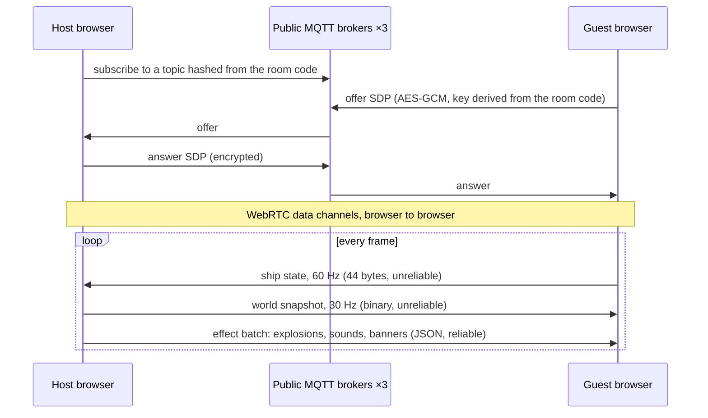
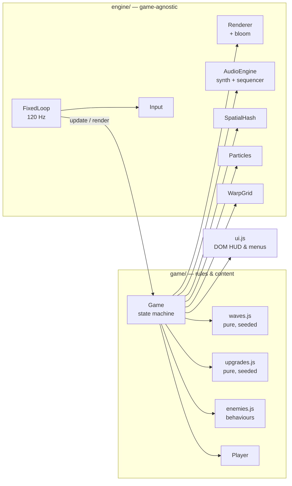

<div align="center">

# VOID PULSE

**A neon twin-stick roguelite built from scratch in vanilla JavaScript.**
Custom engine · online co-op over WebRTC · spring-mass warp grid · synthesized audio · zero dependencies · no build step.

[**▶ Play in the browser**](https://chop-prog.github.io/void-pulse/) &nbsp;·&nbsp; works on desktop, gamepad and mobile


</div>

## Why this project

Most browser games lean on Phaser, Pixi or Three.js. VOID PULSE uses **none** of them. Everything you see and hear (the physics, collision, rendering pipeline, particle system, music sequencer, input layer) is hand-written on top of raw browser APIs: Canvas 2D, Web Audio and the Gamepad API. The whole thing ships as plain ES modules: clone it, serve it, play it.

## Features

- **Online co-op for two.** Create a room, send a friend the link, and fly together. Browsers connect directly over WebRTC. With two pilots, enemies get 60% more health (75% for bosses) and waves are 50% bigger. A downed pilot spectates and rejoins at the start of the next wave; the run ends only when both are down.
- **7 enemy archetypes with distinct AI.** Seekers home in. Dodgers read incoming bullets and sidestep them. Splitters burst into fragments. Snipers hold range and fire telegraphed shots. Singularities bend bullets, drag ships and eat other enemies until they overload. In co-op every enemy targets the nearest pilot.
- **Five bosses in rotation**, every 5th wave, each with an enraged second phase:
  - *Hydra Core*: radial bursts, spirals, aimed volleys and summons;
  - *Laser Warden*: telegraphed laser beams that sweep the arena (two, then four), bullet flowers and dodger escorts;
  - *Brood Mother*: pours out swarms of minis, winds up, and rams the nearest pilot, bursting into a bullet ring on impact;
  - *Void Serpent*: a 14-segment serpent that hunts the nearest pilot. Only its head takes damage; the body is a moving wall that fires rib volleys sideways. In co-op each side lays the body out along the path its head took, so no segment positions travel over the network;
  - *Prism*: blinks around the arena, shrinking before every jump as a tell, bursts on arrival, fires aimed fans, and when enraged splits off mirror copies that keep shooting.
- **Roguelite build-crafting.** 21 augments across 4 rarities, offered as a pick of 3 between waves. Epics show up in about 1 offer in 12 and never more than one per offer. Legendaries are rarer still (about 1 run in 9 sees one) and enter the pool from wave 6: *Bullet Storm* (every 6th volley is a 12-shot ring), *Phoenix Core* (survive one fatal hit with a small blast) and *Chronos* (a dash slows enemies for 1.8 s, once every 6 s). New epics include rear guns, a periodic *Nova Pulse* shockwave and a recharging *Aegis Shield*. In co-op each pilot picks their own.
- **Daily run.** A seed derived from the UTC date gives every player on Earth the same waves and the same upgrade offers.
- **Game feel.** Hit-stop, trauma-based screen shake, a warping background grid, bloom, a score multiplier fed by shards, and a "mercy blast" so a single hit never chains into an instant second death.
- **Every input device.** Keyboard + mouse, gamepad (standard mapping, including menu navigation) and dual floating virtual sticks on touch screens.
- **Installable PWA** that works offline, with persistent best scores and settings.


## Online co-op: how it works



- **No game server.** GitHub Pages only serves static files, so the two browsers find each other through public MQTT brokers ([`mqtt.js`](src/net/mqtt.js) is a ~150-line MQTT 3.1.1 client), swap one WebRTC offer and answer, then talk directly. Signalling goes to three brokers at once, so one being down doesn't matter. Messages are encrypted with a key derived from the room code, and the topic is a hash of the code, so the brokers see only ciphertext ([`signal.js`](src/net/signal.js)).
- **Relay fallback.** Some networks (symmetric NAT and CGNAT, common on mobile carriers) make a direct connection impossible. If no direct path opens within 6 s, both sides switch to a relay through a broker they share ([`relay.js`](src/net/relay.js)). It uses the same interface as the WebRTC link, so the game code doesn't change. Traffic is still encrypted with the room key, snapshots are deflate-compressed and sent at 12 Hz instead of 30, and a snapshot is skipped rather than queued when the broker connection backs up. The lobby says which path you got, and so does the HUD.
- **Host-authoritative simulation.** The host runs the real game (enemies, bullets, damage, scoring, upgrades) and streams a quantised binary snapshot ([`codec.js`](src/net/codec.js)). Positions and velocities are int16 and angles are int16 × 10⁻⁴. Of each enemy's behaviour state, only the fields its type declares in `sync` are sent, because those are all `draw()` needs. A late-game frame with 150 enemies and 1,000 bullets is under 20 KB; a typical one is a few KB.
- **No input lag for the guest.** The guest flies its own ship locally and reports position, aim and trigger; the host fires the guest's guns from that report. Everything else is extrapolated along its velocity between snapshots and eased toward the newest one ([`coop.js`](src/net/coop.js)).
- **Same effects on both screens.** On the host, particle, grid, audio and banner calls go through a recording proxy ([`fx-record.js`](src/game/fx-record.js)), and the guest replays the batch on its own systems. Purely local effects (engine trails, grid wakes) bypass it and are recomputed on each side.
- **Tested without a network.** [`tests/coop.test.js`](tests/coop.test.js) runs a real host `Game` and a real guest `Game` joined by an in-memory link carrying the same messages. It checks that the worlds stay in sync and that the guest's ship and guns work. It also covers the downed-pilot, shared-upgrade, game-over and disconnect flows.

## Engineering highlights

| System | What's interesting |
|---|---|
| **Game loop** ([`loop.js`](src/engine/loop.js)) | Fixed 120 Hz timestep with an accumulator. Physics stays deterministic and frame-rate independent on 60/144/240 Hz displays. |
| **Collision** ([`spatial-hash.js`](src/engine/spatial-hash.js)) | Uniform-grid spatial hash rebuilt every tick, with pooled cell arrays and stamp-based de-duplication, so the steady state allocates nothing. A test checks it against brute force so it never misses an overlap. |
| **Particles** ([`particles.js`](src/engine/particles.js)) | Struct-of-arrays on fixed-capacity typed arrays with swap-remove. Rendering **counting-sorts** particles into (colour × alpha × width) buckets, so thousands of sparks cost one `stroke()` per bucket instead of one each. |
| **Warp grid** ([`grid.js`](src/engine/grid.js)) | Spring-mass lattice: anchor springs plus a discrete-Laplacian coupling term that carries ripples outward, integrated with semi-implicit Euler. Explosions push it, singularities pull it. |
| **Bloom** ([`renderer.js`](src/engine/renderer.js)) | No WebGL and no `ctx.filter`. The frame is downsampled to ¼ and ⅛ resolution (bilinear filtering does the blur) and added back with `lighter` compositing. Works in every browser. |
| **Adaptive quality** ([`main.js`](src/main.js)) | Watches CPU time per frame and FPS, and steps resolution and bloom down when frames stay slow. |
| **Audio** ([`audio.js`](src/engine/audio.js)) | Zero audio files. Every SFX is synthesized from oscillators and filtered noise. Music comes from a 4-bar step sequencer scheduled ahead on the audio clock, and its layers (hats, snare, arpeggio, filter cutoff) open up with on-screen intensity. |
| **Determinism** ([`waves.js`](src/game/waves.js), [`upgrades.js`](src/game/upgrades.js)) | Wave planning and upgrade rolls are pure functions of a seeded Mulberry32 PRNG. That is what makes daily runs reproducible and the logic unit-testable. |
| **Input** ([`input.js`](src/engine/input.js)) | One abstraction over keyboard, mouse, gamepad and touch. One-shot actions are queued and consumed by the fixed-step simulation, so a press is never lost between ticks. |

### Architecture



The **engine** layer knows nothing about the game, and the **game** layer never touches the DOM directly. Rules that matter for fairness (what spawns, where it spawns, which upgrades are offered) live in pure modules with unit tests.

## Controls

| | Keyboard + mouse | Gamepad | Touch |
|---|---|---|---|
| Move | `WASD` | Left stick | Left thumb |
| Aim & fire | Mouse (hold LMB) or arrow keys | Right stick / RT | Right thumb |
| Dash (i-frames) | `Shift` | RB | Dash button |
| Bomb | `Space` / RMB | LB | Bomb button |
| Pause | `Esc` / `P` | Start | ⏸ |
| Debug overlay | `` ` `` or `F3` | | |

The debug overlay shows FPS, CPU time per frame, quality level, entity counts and the live spatial-hash cells. You can also open it with `?debug` in the URL.

## Run locally

On Windows, just double-click **`start.bat`**: it starts the server and opens the game in your browser.

Otherwise, note that ES modules must be served over HTTP (opening `index.html` from disk won't work):

```bash
npm start          # zero-dependency dev server → http://localhost:5173
npm test           # 60 tests on Node's built-in test runner
```

Any static server works too, for example `python -m http.server`.

## Tests & CI

`npm test` runs the suites in [`tests/`](tests) with `node:test` and needs no installs. They cover:

- the spatial hash against brute force, negative coordinates and multi-cell objects;
- the warp grid settling back to rest and keeping its border pinned;
- particle capacity, motion and swap-remove packing;
- wave plans: budget, unlock order, boss cadence, and determinism per seed;
- spawn formations: always inside the arena and at a safe distance from every pilot;
- upgrade rolls: no duplicates, no maxed upgrades, rarity distribution, at most one epic or legendary per offer, legendaries held back until wave 6, and the measured odds over simulated runs;
- bosses: each of the five survives 25 s of its own pattern, enrages at half health and dies cleanly; laser hitboxes;
- the co-op wire format (snapshot and input round-trips, size budget), MQTT packet framing across split chunks, room codes and encrypted signalling;
- a full co-op session between two in-memory games;
- the relay link over an in-memory broker: message order through async encryption, compressed snapshots, back-pressure, wrong-key messages, goodbye;
- PRNG uniformity, angle wrapping, and frame-rate-independent damping.

[GitHub Actions](.github/workflows/ci.yml) runs the tests on Node 22 and 24 for every push and PR, then deploys `main` to GitHub Pages.

## Project structure

```
src/
  engine/          game-agnostic: loop, input, audio, renderer, particles, grid, spatial hash, math
  game/            game.js (state machine & systems), enemies & bosses, player, waves, upgrades, fx recording
  net/             online co-op: MQTT signalling, WebRTC link, binary codec, session sync
  ui.js            DOM HUD, menus, upgrade cards, game-over summary
  main.js          bootstrap, settings, adaptive quality, PWA registration
tests/             node:test suites for the pure modules
sw.js              offline cache (stale-while-revalidate)
```

## Deploy your own copy

1. Push this folder to a GitHub repository named `void-pulse`.
2. Go to **Settings → Pages → Source** and choose **GitHub Actions**.
3. The next push to `main` publishes the game at `https://<username>.github.io/void-pulse/`.

## License

[MIT](LICENSE)
