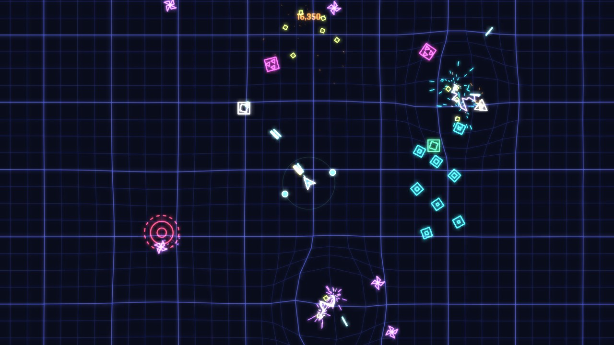
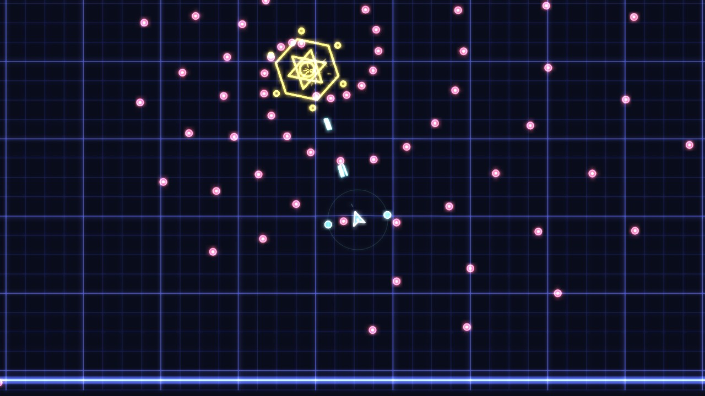
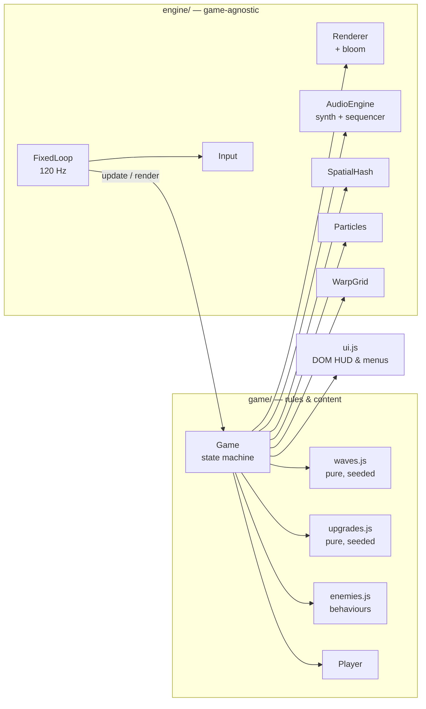

<div align="center">

# VOID PULSE

**A neon twin-stick roguelite built from scratch in vanilla JavaScript.**
Custom engine · spring-mass warp grid · synthesized audio · zero dependencies · no build step.

[**▶ Play in the browser**](https://chop-prog.github.io/void-pulse/) &nbsp;·&nbsp; works on desktop, gamepad and mobile



</div>

## Why this project

Most browser games lean on Phaser, Pixi or Three.js. VOID PULSE uses **none** of them. Everything you see and hear (the physics, collision, rendering pipeline, particle system, music sequencer, input layer) is hand-written on top of raw browser APIs: Canvas 2D, Web Audio and the Gamepad API. The whole thing ships as plain ES modules: clone it, serve it, play it.

## Features

- **7 enemy archetypes with distinct AI.** Seekers home in. Dodgers read incoming bullets and sidestep them. Splitters burst into fragments. Snipers hold range and fire telegraphed shots. Singularities bend bullets, drag the player and eat other enemies until they overload.
- **Boss fight.** Every 5th wave brings the *Hydra Core*. It has four attack patterns (radial burst, spiral, aimed volleys, summons) and an enraged second phase.
- **Roguelite build-crafting.** 15 augments across 3 rarities (multishot, piercing, ricochet, homing, orbital drones, chain lightning and more), offered as a pick of 3 between waves.
- **Daily run.** A seed derived from the UTC date gives every player on Earth the same waves and the same upgrade offers.
- **Game feel.** Hit-stop, trauma-based screen shake, a warping background grid, bloom, a score multiplier fed by shards, and a "mercy blast" so a single hit never chains into an instant second death.
- **Every input device.** Keyboard + mouse, gamepad (standard mapping, including menu navigation) and dual floating virtual sticks on touch screens.
- **Installable PWA** that works offline, with persistent best scores and settings.



## Engineering highlights

| System | What's interesting |
|---|---|
| **Game loop** ([`loop.js`](src/engine/loop.js)) | Fixed 120 Hz timestep with an accumulator. Physics stays deterministic and frame-rate independent on 60/144/240 Hz displays. |
| **Collision** ([`spatial-hash.js`](src/engine/spatial-hash.js)) | Uniform-grid spatial hash rebuilt every tick, with pooled cell arrays and stamp-based de-duplication, so the steady state allocates nothing. A test checks it against brute force so it never misses an overlap. |
| **Particles** ([`particles.js`](src/engine/particles.js)) | Struct-of-arrays on fixed-capacity typed arrays with swap-remove. Rendering **counting-sorts** particles into (colour × alpha × width) buckets, so thousands of sparks cost one `stroke()` per bucket instead of one each. |
| **Warp grid** ([`grid.js`](src/engine/grid.js)) | Spring-mass lattice: anchor springs plus a discrete-Laplacian coupling term that carries ripples outward, integrated with semi-implicit Euler. Explosions push it, singularities pull it. |
| **Bloom** ([`renderer.js`](src/engine/renderer.js)) | No WebGL and no `ctx.filter`. The frame is downsampled to ¼ and ⅛ resolution (bilinear filtering does the blur) and added back with `lighter` compositing. Works in every browser. |
| **Adaptive quality** ([`main.js`](src/main.js)) | Watches CPU time per frame and FPS, and steps resolution and bloom down when frames stay slow. |
| **Audio** ([`audio.js`](src/engine/audio.js)) | Zero audio files. Every SFX is synthesized from oscillators and filtered noise. Music comes from a 4-bar step sequencer scheduled ahead on the audio clock, and its layers (hats, snare, arpeggio, filter cutoff) open up with on-screen intensity. |
| **Determinism** ([`waves.js`](src/game/waves.js), [`upgrades.js`](src/game/upgrades.js)) | Wave planning and upgrade rolls are pure functions of a seeded Mulberry32 PRNG. That is what makes daily runs reproducible and the logic unit-testable. |
| **Input** ([`input.js`](src/engine/input.js)) | One abstraction over keyboard, mouse, gamepad and touch. One-shot actions are queued and consumed by the fixed-step simulation, so a press is never lost between ticks. |

### Architecture



The **engine** layer knows nothing about the game, and the **game** layer never touches the DOM directly. Rules that matter for fairness (what spawns, where it spawns, which upgrades are offered) live in pure modules with unit tests.

## Controls

| | Keyboard + mouse | Gamepad | Touch |
|---|---|---|---|
| Move | `WASD` | Left stick | Left thumb |
| Aim & fire | Mouse (hold LMB) or arrow keys | Right stick / RT | Right thumb |
| Dash (i-frames) | `Shift` | RB | Dash button |
| Bomb | `Space` / RMB | LB | Bomb button |
| Pause | `Esc` / `P` | Start | ⏸ |
| Debug overlay | `` ` `` or `F3` | | |

The debug overlay shows FPS, CPU time per frame, quality level, entity counts and the live spatial-hash cells. You can also open it with `?debug` in the URL.

## Run locally

On Windows, just double-click **`start.bat`**: it starts the server and opens the game in your browser.

Otherwise, note that ES modules must be served over HTTP (opening `index.html` from disk won't work):

```bash
npm start          # zero-dependency dev server → http://localhost:5173
npm test           # 27 unit tests on Node's built-in test runner
```

Any static server works too, for example `python -m http.server`.

## Tests & CI

`npm test` runs the suites in [`tests/`](tests) with `node:test` and needs no installs. They cover:

- the spatial hash against brute force, negative coordinates and multi-cell objects;
- the warp grid settling back to rest and keeping its border pinned;
- particle capacity, motion and swap-remove packing;
- wave plans: budget, unlock order, boss cadence, and determinism per seed;
- spawn formations: always inside the arena and at a safe distance from the player;
- upgrade rolls: no duplicates, no maxed upgrades, rarity distribution;
- PRNG uniformity, angle wrapping, and frame-rate-independent damping.

[GitHub Actions](.github/workflows/ci.yml) runs the tests on Node 20 and 22 for every push and PR, then deploys `main` to GitHub Pages.

## Project structure

```
src/
  engine/          game-agnostic: loop, input, audio, renderer, particles, grid, spatial hash, math
  game/            game.js (state machine & systems), enemies, player, waves, upgrades
  ui.js            DOM HUD, menus, upgrade cards, game-over summary
  main.js          bootstrap, settings, adaptive quality, PWA registration
tests/             node:test suites for the pure modules
sw.js              offline cache (stale-while-revalidate)
```

## Deploy your own copy

1. Push this folder to a GitHub repository named `void-pulse`.
2. Go to **Settings → Pages → Source** and choose **GitHub Actions**.
3. The next push to `main` publishes the game at `https://<username>.github.io/void-pulse/`.

## License

[MIT](LICENSE)
